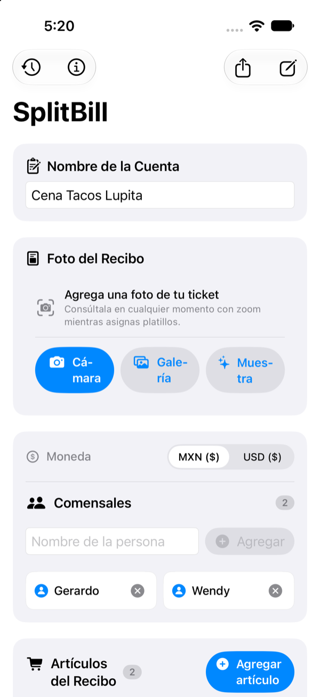

<p align="center">
  
</p>

<h1 align="center">SplitBill</h1>

<p align="center">
  <b>Modern, Local-First Restaurant Bill Splitting for iOS 18+</b><br>
  Built with Swift 6 Strict Concurrency, Pure Domain Separation, On-Device Vision OCR, and Exact Minor-Unit Financial Mathematics.
</p>

<p align="center">
  <a href="https://github.com/gerar-18/split-bill/actions/workflows/ci.yml">
    
  </a>
  
  
  
  
  
  
  
  <a href="LICENSE">
    
  </a>
</p>

---

## 📱 Visual Overview

<p align="center">
  
</p>

<p align="center">
  <b>Scan</b> receipt ticket &nbsp;→&nbsp; 
  <b>Review</b> items & amounts &nbsp;→&nbsp; 
  <b>Assign</b> participants &nbsp;→&nbsp; 
  <b>Split</b> with penny precision &nbsp;→&nbsp; 
  <b>Share</b> summary
</p>

---

## 💡 What Makes SplitBill Different?

Most bill-splitting apps rely on binary floating-point (`Double` / `Float`) that introduce fractional penny rounding errors, require forced accounts before showing any value, or send private user receipts to third-party servers.

**SplitBill** is engineered from first principles as an **offline-first, resilient, privacy-guaranteed mobile application**:
- **Zero Floating-Point Representation**: All monetary values use exact integer minor units (`Int64` cents/centavos) with the **Hamilton largest-remainder method** for deterministic odd-cent allocation.
- **On-Device Computer Vision**: Apple's native `Vision` framework performs optical character recognition locally on the Apple Neural Engine, paired with a custom geometric row-clustering algorithm.
- **Strict Domain Boundary ([ADR-002](docs/decisions/ADR-002-domain-separation.md))**: The business logic is 100% independent of SwiftUI and SwiftData, preventing UI framework churn from compromising core calculations.
- **Swift 6 Strict Concurrency**: Fully annotated with `@MainActor`, value types, immutable structures, and actor reentrancy guards.
- **Zero External Third-Party SDKs**: 100% pure native Apple frameworks (SwiftUI, Observation, SwiftData, Vision, PhotosUI, Swift Testing).

---

## 🏛️ Engineering Highlights (Direct Code Links)

| Feature / Pattern | Key Files & Architectural Concept |
|---|---|
| **Exact Penny Math & Hamilton Allocation** | [`Money.swift`](apps/SplitBill/SplitBill/Domain/Money.swift) & [`SplitEngine.swift`](apps/SplitBill/SplitBill/Domain/SplitEngine.swift)<br>Enforces Master Conservation: $\sum \text{allocated} \equiv \text{receipt total}$. Odd tax/tip cents are deterministically awarded by descending remainder ranking. |
| **Multi-Provider AI Extraction Proxy** | [`ai-proxy.service.ts`](services/api/src/modules/ai-proxy/ai-proxy.service.ts) & [`HTTPProxyAIReceiptParserService.swift`](apps/SplitBill/SplitBill/Infrastructure/AI/AIReceiptParserService.swift)<br>NestJS gateway with adapter for DeepSeek (JSON mode), local Ollama, and $0 zero-cost heuristic fallback, enforcing integer cents reconciliation. |
| **Apple Guideline 5.1.2(i) Informed Consent** | [`AIConsentSheet.swift`](apps/SplitBill/SplitBill/UI/Views/AIConsentSheet.swift) & [`AIConsentManager.swift`](apps/SplitBill/SplitBill/Infrastructure/AI/AIConsentManager.swift)<br>Modal consent sheet explaining data minimization, purpose, and revocability before any network extraction payload is sent. |
| **Cloud Sync & PostgreSQL Invariants** | [`receipts.service.ts`](services/api/src/modules/receipts/receipts.service.ts) & [`schema.prisma`](services/api/prisma/schema.prisma)<br>Production NestJS REST API with PostgreSQL, Prisma ORM, BigInt minor units cents, bearer token auth, and fast-check property testing. |
| **Live QR Collaboration & UGC Safety** | [`collaboration.service.ts`](services/api/src/modules/collaboration/collaboration.service.ts) & [`SharedSessionViewModel.swift`](apps/SplitBill/SplitBill/UI/State/SharedSessionViewModel.swift)<br>Zero-login anonymous capability tokens, `@Sse` live stream + `expectedVersion` optimistic concurrency (`409`), opt-in-only receipt photo, and Apple Guideline 1.2 moderation/quarantine controls. |
| **On-Device OCR & Geometric Row Clustering** | [`ReceiptOCRService.swift`](apps/SplitBill/SplitBill/Infrastructure/OCR/ReceiptOCRService.swift) & [`ReceiptOCRModels.swift`](apps/SplitBill/SplitBill/Infrastructure/OCR/ReceiptOCRModels.swift)<br>Transforms normalized Vision bounding boxes (`midY`, `minX`) into logical receipt rows while offloading heavy vision requests from the cooperative thread pool. |
| **Deterministic Parser & Reconciliation** | [`DeterministicReceiptParser.swift`](apps/SplitBill/SplitBill/Domain/DeterministicReceiptParser.swift) & [`ParsedReceiptReviewDraft.swift`](apps/SplitBill/SplitBill/UI/State/ParsedReceiptReviewDraft.swift)<br>Parses items, unit prices, IVA and tips with regex lookbehind; reconciles $\sum \text{items} + \text{tax} == \text{total}$ in real-time before import. |
| **Resilient Persistence with Fallback** | [`ReceiptStore.swift`](apps/SplitBill/SplitBill/Infrastructure/Persistence/ReceiptStore.swift) & [`StoredReceipt.swift`](apps/SplitBill/SplitBill/Infrastructure/Persistence/StoredReceipt.swift)<br>Automated SwiftData store with graceful in-memory container fallback preventing launch crashes if disk storage fails. |
| **Concurrency & Actor Reentrancy Guards** | [`ReceiptEditorViewModel.swift`](apps/SplitBill/SplitBill/UI/State/ReceiptEditorViewModel.swift)<br>Captures active receipt snapshot tokens to prevent out-of-order OCR completion from overwriting newly opened sessions. |
| **Visual Card Exporter (`ImageRenderer`)** | [`ReceiptShareCardView.swift`](apps/SplitBill/SplitBill/UI/Views/ReceiptShareCardView.swift) & [`ReceiptSharePreviewSheet.swift`](apps/SplitBill/SplitBill/UI/Views/ReceiptSharePreviewSheet.swift)<br>Renders high-resolution Retina (@3x) infographic receipt cards using `ImageRenderer` and native `Transferable` PNG export. |
| **App Store Compliance & Privacy Manifest** | [`PrivacyInfo.xcprivacy`](apps/SplitBill/SplitBill/PrivacyInfo.xcprivacy) & [`AboutPrivacySheet.swift`](apps/SplitBill/SplitBill/UI/Views/AboutPrivacySheet.swift)<br>Official Apple Privacy Manifest declaring zero tracking, plus in-app privacy disclosures meeting Guidelines 1.5, 5.1.1(i) & 5.1.2(i). |

---

## 🏗️ Architecture

SplitBill enforces a unidirectional Clean Architecture layout with an optional cloud sync gateway:

```text
iOS App (Swift 6 · Local-First)
  ├── UI Layer: SwiftUI Views + Observation (@Observable)
  ├── Domain Layer: Pure Swift (Money cents, SplitEngine, Deterministic Parser)
  └── Infrastructure: SwiftData Store, Vision OCR, HTTP AI Proxy Client
            ↕ (Optional / Opt-in HTTPS Sync & AI Parsing)
Backend Gateway (NestJS · Docker Compose)
  ├── Auth & Rate Limiting Guards (20 req/min sliding window)
  ├── AI Proxy Module (Domain Validator cents reconciliation)
  │     ├── DeepSeek / OpenAI (Remote API with JSON Mode)
  │     ├── Ollama (Local LLM via host network)
  │     └── Heuristic Regex Fallback ($0 offline)
  └── Receipts Sync Service (PostgreSQL 16 via Prisma ORM)
```

Architectural decisions are tracked in formal **Architecture Decision Records (ADRs)**:
- [ADR-001 — Local-First Initial Architecture](docs/decisions/ADR-001-local-first.md)
- [ADR-002 — Keep Domain Logic Independent from UI](docs/decisions/ADR-002-domain-separation.md)
- [ADR-003 — Introduce LLM Parsing After Deterministic Baseline](docs/decisions/ADR-003-ai-after-deterministic-parser.md)
- [ADR-004 — Two-Wave Release Strategy & App Store Guardrails](docs/decisions/ADR-004-appstore-release-strategy.md)

---

## 🗺️ Architecture Roadmap & Future Evolution

### Wave 1 — v1.0 Local-First (Complete)

| Milestone | Target | Focus | Status |
|---|---|---|:---:|
| **M0** | `v0.0.1` | Engineering foundation, CI pipeline, and agent constitution | ✅ Complete |
| **M1** | `v0.1.0` | Exact financial split engine (Hamilton method) | ✅ Complete |
| **M2** | `v0.2.0` | Reactive SwiftUI UI (4 split modes, VoiceOver, Dynamic Type) | ✅ Complete |
| **M3** | `v0.3.0` | SwiftData persistence surviving app restarts | ✅ Complete |
| **M4** | `v0.4.0` | Camera capture, photo picker, and pinch-to-zoom viewer | ✅ Complete |
| **M5** | `v0.5.0` | On-device Vision OCR with geometric line reconstruction | ✅ Complete |
| **M6** | `v0.6.0` | Deterministic parsing with real-time financial reconciliation | ✅ Complete |
| **M6.5** | `v1.0.0` | App Store readiness (`PrivacyInfo.xcprivacy`, 1024px icon, bundle tests) | ✅ Complete |
| **M6.6** | `v1.0.0` | Portfolio showcase, MIT license, visual assets, and sideloading guide | ✅ Complete |

### Wave 2 — Cloud Architecture, Multi-Device Sync & Collaboration

| Milestone | Target | Focus | Status |
|---|---|---|:---:|
| **M6.7** | `v1.1.0` | **Visual Receipt Card Exporter (`ImageRenderer`)** — Render a shareable image/card breakdown for WhatsApp / iMessage | ✅ Complete |
| **M7** | `v1.2.0` | **Local Cloud Backend (Docker Compose)** — NestJS + PostgreSQL containerized with Docker Compose for multi-device sync | ✅ Complete |
| **M7.5** | `v1.3.0` | **AI Extraction Proxy** — LLM parser proxy via backend with explicit user consent modal | ✅ Complete |
| **M8** | `v1.4.0` | **Shared Receipt Collaboration** — Real-time sessions via QR / Universal Links | ✅ Complete |
| **M9** | `v2.0.0` | **Commercial App Store Release** — Production deployment with TestFlight & StoreKit 2 subscriptions | ⏳ Next |

---

## 🧪 Testing & Verification

The repository enforces automated verification across both the iOS client and backend services with **279 automated tests**:

- **iOS Swift Testing (159 tests across 23 suites)**:
  - Financial conservation invariants, Hamilton largest remainder tie-breaking.
  - SwiftData persistence, error recovery, and background OCR actor reentrancy.
  - Apple Guideline 5.1.2(i) AI consent lifecycle, Deep Link Crockford validation, and Guideline 1.2 UGC moderation controls.
- **Backend Jest & Fast-Check (120 tests across 10 suites)**:
  - BigInt minor unit cents serialization and PostgreSQL idempotency.
  - Optimistic concurrency (`expectedVersion`), SSE state transitions, and auto-quarantine moderation invariants.
  - Sliding-window rate limiting (`429`) and adversarial fuzzing against prompt injection, malformed images, and XSS/HTML injection.

To run the complete verification suite locally:

```bash
# Verify iOS application (architecture boundaries, build, and Swift Testing)
./scripts/verify.sh

# Verify Backend API (NestJS build and Jest test suites)
cd services/api && npm test
```

Every push and pull request automatically triggers parallel verification in GitHub Actions:
1. **iOS Pipeline (`macos-latest`)**: Swift 6 strict concurrency, boundary checks, and 159 tests.
2. **Backend Pipeline (`ubuntu-latest`)**: Node 20, NestJS build, and 120 unit/adversarial tests.

---

## 🚀 Running SplitBill Locally

### In the Simulator (macOS + Xcode 16+)
1. Clone this repository:
   ```bash
   git clone https://github.com/gerar-18/split-bill.git
   cd split-bill
   ```
2. Open the project in Xcode:
   ```bash
   open apps/SplitBill/SplitBill.xcodeproj
   ```
3. Select any iPhone simulator (e.g., iPhone 16 or iPhone 17) and press **Run (`⌘R`)**.
4. To test incoming collaborative invite links in the iOS Simulator:
   ```bash
   xcrun simctl openurl booted "splitbill://join?code=ABCD2345"
   ```

### Running Backend API & Local AI Proxy (Docker Compose)
To run the sync service and multi-provider AI proxy locally:
1. Navigate to the backend directory and configure the environment:
   ```bash
   cd services/api
   cp .env.example .env
   ```
2. Start PostgreSQL and the NestJS API with Docker Compose:
   ```bash
   docker compose up -d
   ```
3. Run backend unit and adversarial tests:
   ```bash
   npm test
   ```

### On a Physical iPhone (Developer Sideloading)
SplitBill can be deployed directly to your personal physical device using standard Apple Developer personal signing:
1. Open `apps/SplitBill/SplitBill.xcodeproj` in Xcode.
2. In **Xcode → Settings → Accounts**, click **`+`** and sign in with your Apple ID.
3. Select the **`SplitBill`** target → **Signing & Capabilities** tab.
4. Check **Automatically manage signing** and select your **Personal Team**.
5. Connect your iPhone via USB cable or Wi-Fi, select it in the scheme bar, and press **Run (`⌘R`)**.
6. On your iPhone, navigate to **Settings → General → VPN & Device Management**, select your developer profile, and tap **Trust**.

---

## 📄 License & Author

Distributed under the **MIT License**. See [`LICENSE`](LICENSE) for details.

Developed with passion by **Gerardo** ([@gerar-18](https://github.com/gerar-18)).
