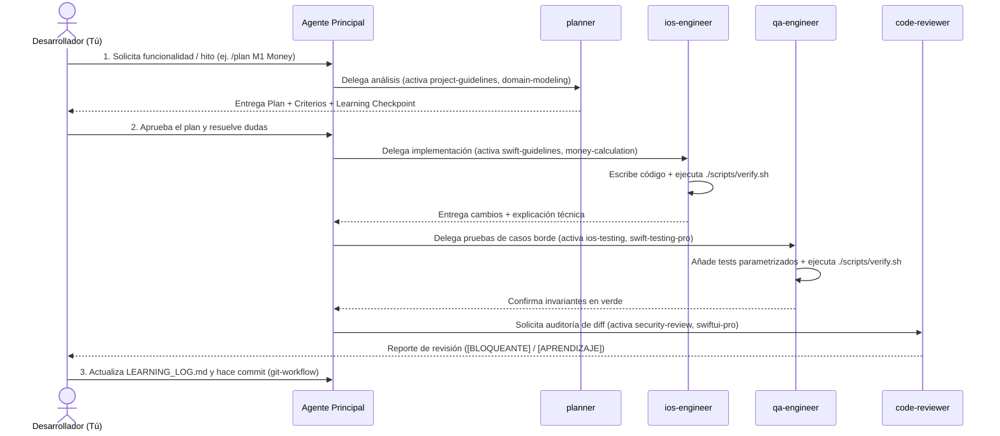

# Flujo de Trabajo Agéntico (Agent Workflow)

Este documento describe el flujo práctico paso a paso para construir cada funcionalidad de SplitBill combinando tu criterio de ingeniería con los subagentes y skills del repositorio.

---

## 1. Ciclo Completo de una Funcionalidad

---

## 2. Guía Rápida de Prompts para el Desarrollador

Puedes dejar que el agente principal orqueste automáticamente a los subagentes, o bien invocarlos de forma explícita según la etapa en la que estés:

### Etapa 1: Planificación y Diseño
> **Ejemplo de prompt**:
> `/plan Usa el subagente planner y las skills domain-modeling y money-calculation para diseñar la primera tarea del hito M1 (el tipo Money y su aritmética en centavos).`

### Etapa 2: Implementación Guiada
> **Ejemplo de prompt**:
> `El plan está aprobado. Usa ios-engineer para implementar el modelo Money en Domain/ y explícamelo paso a paso.`

### Etapa 3: Pruebas Exhaustivas y Casos Borde (QA)
> **Ejemplo de prompt**:
> `Usa qa-engineer con la skill swift-testing-pro para agregar pruebas parametrizadas de casos borde (0 centavos, 1 centavo, centavos impares) y corre ./scripts/verify.sh.`

### Etapa 4: Revisión de Código y Seguridad antes de Commit
> **Ejemplo de prompt**:
> `Usa code-reviewer junto con la skill security-review para auditar el git diff actual antes de hacer commit.`

---

## 3. Reglas de Oro del Flujo

1. **Verificación Real**: Ningún agente puede afirmar que un comando, compilación o prueba pasó sin haber ejecutado realmente `./scripts/verify.sh` y comprobado su salida.
2. **Cambios Pequeños y Atómicos**: Cada iteración debe abordar una tarea pequeña y coherente (por ejemplo, primero `Money`, luego `ReceiptItem`, luego `SplitEngine`), haciendo un commit limpio al terminar cada una.
3. **Aprendizaje Activo**: Si cualquier línea de código generada por el agente no te resulta 100% clara, pídele que la desglose antes de pasar a la siguiente tarea.
