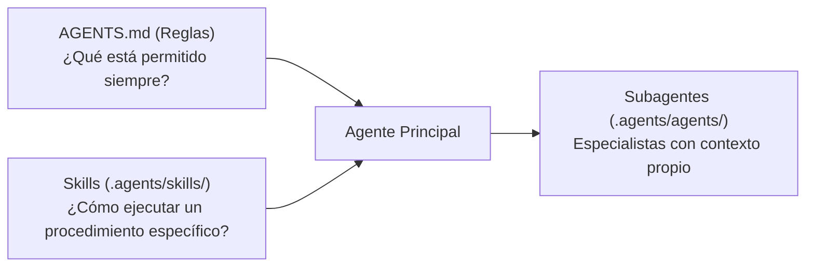

# Guía de Agentes y Skills — Cuándo y Cómo Usarlos

Antigravity descubre automáticamente los subagentes del proyecto en [`.agents/agents/`](../../.agents/agents) y las skills en [`.agents/skills/`](../../.agents/skills).

Esta guía explica **cuándo y cómo debe usarlos tanto el desarrollador (humano) como el agente de código**.

---

## 1. Diferencia Conceptual: Reglas vs. Skills vs. Subagentes



1. **Reglas ([`AGENTS.md`](../../AGENTS.md))**: Siempre están cargadas en memoria. Definen las leyes inquebrantables del proyecto (ej. prohibido usar `Double` para dinero; `Domain` no importa `SwiftUI`).
2. **Skills ([`.agents/skills/*/SKILL.md`](../../.agents/skills))**: Se cargan **bajo demanda** (*Progressive Disclosure*). El agente solo ve su nombre y descripción; cuando una tarea lo requiere, lee el archivo completo para obtener comandos, ejemplos y checklists.
3. **Subagentes ([`.agents/agents/*.md`](../../.agents/agents))**: Son colaboradores especializados con su propia ventana de contexto aislada para planificar, programar, probar o auditar código sin contaminar la conversación principal.

---

## 2. Cuándo Usar Cada Subagente

| Subagente | ¿Cuándo lo usa el Agente de Código? | ¿Cómo lo pides tú (Desarrollador)? | Entregable que produce |
|---|---|---|---|
| **[`planner`](../../.agents/agents/planner.md)** | Antes de programar cualquier hito nuevo (`M1`–`M9`) o cambio que toque múltiples archivos. | `/plan Diseña el modelo Money y las pruebas de M1` o *"Usa `planner` para dividir el hito M1 en tareas pequeñas"* | Plan paso a paso, criterios de aceptación, invariantes y un *Learning Checkpoint*. |
| **[`ios-engineer`](../../.agents/agents/ios-engineer.md)** | Cuando ya aprobaste un plan y hay que escribir código Swift/SwiftUI en `apps/SplitBill/`. | *"Usa `ios-engineer` para implementar la Tarea 1 del plan"* | Código en `Domain/` o `UI/`, ejecución de `./scripts/verify.sh` y notas de aprendizaje. |
| **[`backend-engineer`](../../.agents/agents/backend-engineer.md)** | Para escribir o modificar código NestJS, esquemas PostgreSQL, Docker Compose o APIs en `services/api/`. | *"Usa `backend-engineer` para implementar el endpoint de sync"* | Código en `services/api/`, migraciones SQL, validación DTO y tests de backend. |
| **[`qa-engineer`](../../.agents/agents/qa-engineer.md)** | Después de implementar una funcionalidad para validar criterios de aceptación y casos borde en `SplitBillTests/` o `services/api/test/`. | *"Pídele a `qa-engineer` que verifique los criterios de aceptación"* | Suite de pruebas con `Swift Testing` o Jest, reporte de cobertura y `./scripts/verify.sh`. |
| **[`adversarial-tester`](../../.agents/agents/adversarial-tester.md)** | Red-Team testing: intentar activamente romper invariantes financieros, parsers, idempotencia de sync y límites concurrentes. | *"Ejecuta pruebas adversariales sobre [módulo] con `adversarial-tester`"* | Pruebas de propiedades (`property-based-testing`), suites de estrés, contraejemplos mínimos y reporte de resiliencia. |
| **[`code-reviewer`](../../.agents/agents/code-reviewer.md)** | Antes de hacer `git commit` para auditar el `git diff` sin modificar archivos. | *"Ejecuta `code-reviewer` sobre mis cambios actuales antes de hacer commit"* | Reporte de hallazgos clasificado en `[BLOQUEANTE]`, `[IMPORTANTE]`, `[SUGERENCIA]` y `[APRENDIZAJE]`. |

---

## 3. Catálogo de Skills y Cuándo Activarlas

Tenemos **16 skills** divididas en dos grupos que trabajan en equipo:

### A. Skills del Proyecto (Reglas y Arquitectura de SplitBill)

| Skill | ¿Cuándo se activa? | ¿Qué le enseña al agente? |
|---|---|---|
| **[`project-guidelines`](../../.agents/skills/project-guidelines/SKILL.md)** | Al iniciar cualquier tarea o buscar documentación. | Mapa del repositorio, tabla de ruteo de `docs/` y Definition of Done. |
| **[`domain-modeling`](../../.agents/skills/domain-modeling/SKILL.md)** | Al crear o editar modelos en `apps/SplitBill/SplitBill/Domain/`. | Tipos de valor (`struct`/`enum`), errores tipados (`throws(DomainError)`) y cero dependencias de UI. |
| **[`money-calculation`](../../.agents/skills/money-calculation/SKILL.md)** | Al programar o probar dinero, impuestos, propinas o divisiones. | Representación en centavos enteros (`Int64` / `BIGINT`), invariante de suma total y algoritmo *Largest Remainder*. |
| **[`backend-guidelines`](../../.agents/skills/backend-guidelines/SKILL.md)** | Al trabajar en `services/api/`, esquemas PostgreSQL o sincronización iOS-Backend. | Invariantes monetarios en BD (`BIGINT`), sincronización Local-First idempotente con UUIDs, y Docker Compose reproducible. |
| **[`swift-guidelines`](../../.agents/skills/swift-guidelines/SKILL.md)** | Al escribir cualquier archivo `.swift` del proyecto. | Configuración de Xcode 27 (`MainActor` por defecto), seguridad de opcionales (cero `!`) e inmutabilidad. |
| **[`swiftui-guidelines`](../../.agents/skills/swiftui-guidelines/SKILL.md)** | Al construir pantallas o ViewModels en `apps/SplitBill/SplitBill/UI/`. | Uso de `@Observable`, `@State`, `@Bindable`, `#Preview` y separación de lógica de negocio. |
| **[`ios-testing`](../../.agents/skills/ios-testing/SKILL.md)** | Al crear o correr tests en `apps/SplitBill/SplitBillTests/`. | Ejecución de `./scripts/verify.sh` y pruebas parametrizadas de dominio con `Swift Testing`. |
| **[`git-workflow`](../../.agents/skills/git-workflow/SKILL.md)** | Antes de hacer `git add`, `git commit` o crear ramas. | Checklist pre-commit, formato *Conventional Commits* (`feat:`, `test:`, `fix:`) e higiene de Xcode. |

### B. Skills de la Comunidad Instaladas vía `find-skills` (Maestría Técnica)

| Skill | Fuente / Autor | ¿Cuándo se activa? | ¿Qué aporta? |
|---|---|---|---|
| **[`property-based-testing`](../../.agents/skills/property-based-testing/SKILL.md)** | **Trail of Bits** | Durante pruebas de `adversarial-tester` o `qa-engineer` sobre dinero, parsers o sync. | Formulación y verificación de propiedades sobre todo el dominio de entrada (roundtrip, idempotencia, invariantes algebraicos y búsqueda de contraejemplos). |
| **[`nestjs-best-practices`](../../.agents/skills/nestjs-best-practices/SKILL.md)** | `kadajett` | Al diseñar o programar controladores, servicios y DTOs en `services/api/`. | 40 reglas de arquitectura modular en NestJS, inyección de dependencias limpia, Exception Filters y seguridad. |
| **[`postgresql-table-design`](../../.agents/skills/postgresql-table-design/SKILL.md)** | `wshobson/agents` | Al diseñar tablas, índices y constraints de PostgreSQL. | Diseño en 3NF, indexación manual de Foreign Keys, tipos nativos (`TIMESTAMPTZ`, `UUID`, `BIGINT`, `JSONB`) y prevención de bloqueos. |
| **[`swiftui-pro`](../../.agents/skills/swiftui-pro/SKILL.md)** | `twostraws` (Paul Hudson) | Al diseñar o revisar código de vistas SwiftUI. | Reglas expertas de APIs modernas de SwiftUI, rendimiento, navegación y reemplazo de APIs deprecadas. |
| **[`swift-testing-pro`](../../.agents/skills/swift-testing-pro/SKILL.md)** | `twostraws` (Paul Hudson) | Al escribir suites avanzadas en `SplitBillTests/`. | Uso profundo de `#expect`, `#require`, traits, concurrencia en tests y organización de suites. |
| **[`swift-concurrency-pro`](../../.agents/skills/swift-concurrency-pro/SKILL.md)** | `twostraws` (Paul Hudson) | Al trabajar con `async/await`, actores, `Sendable` o `@MainActor`. | Diagnóstico y prevención de data races y errores de concurrencia estricta en Swift 6.2+. |
| **[`mobile-ios-design`](../../.agents/skills/mobile-ios-design/SKILL.md)** | `wshobson/agents` | Al diseñar flujos de usuario, pantallas, tipografía y controles táctiles. | Principios de Apple Human Interface Guidelines (HIG), ergonomía táctil, modo oscuro y accesibilidad. |
| **[`security-review`](../../.agents/skills/security-review/SKILL.md)** | `getsentry/skills` (Sentry) | Durante revisiones de código (`code-reviewer`, `adversarial-tester`) o manejo de datos/red. | Auditoría de seguridad en diffs, validación de entradas, manejo seguro de datos y prevención de fugas de información. |
| **`find-skills`** *(Global)* | Built-in CLI | Cuando se requiera buscar nuevas skills en el ecosistema. | Busca e instala paquetes verificados desde `skills.sh` usando `npx skills find`. |

---

## 4. Nota Técnica sobre el CLI `npx skills`

El paquete CLI `skills` utiliza `styleText` de `node:util` (introducido en Node.js `20.12+`). En este entorno, para buscar o instalar nuevas skills en el futuro, asegúrate de tener Node 24 de `nvm` en tu `PATH`:

```bash
export PATH="$HOME/.nvm/versions/node/v24.22.1/bin:$PATH"
npx skills find <keyword>
npx skills add <owner/repo@skill> -a antigravity --copy -y
```
